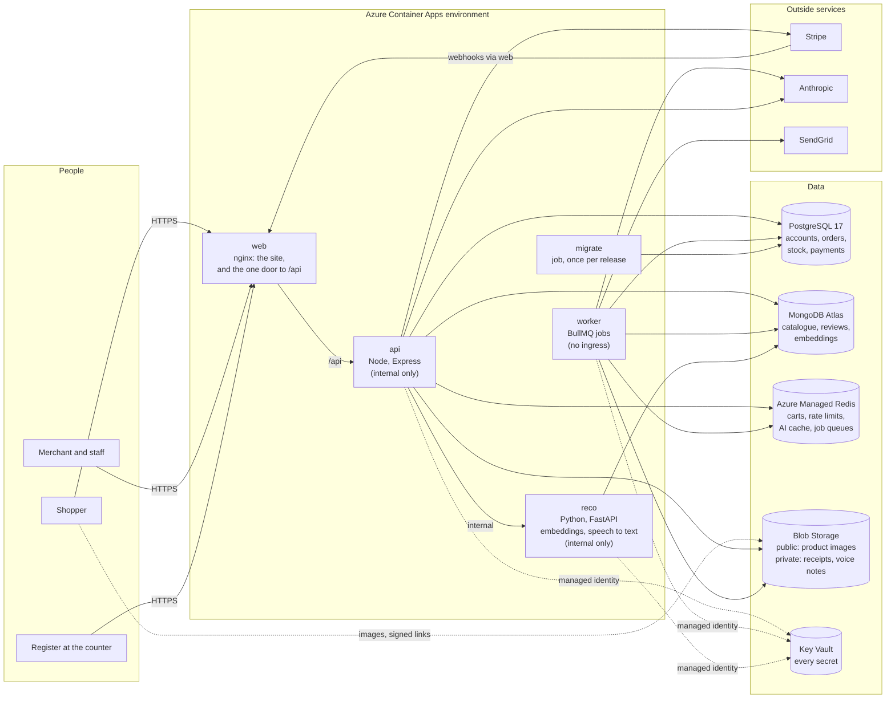

# ZYRO: Architecture

How the parts of ZYRO fit together, in production and on a developer's machine. The reasons behind
the larger choices are in `adr/`, one decision per file.

## The system

## The parts

| Part | Code | What it does |
|---|---|---|
| **web** | `frontend/` + `frontend/nginx/` | Serves the React app (storefront, merchant dashboard, register) and forwards `/api` to the API, so the browser sees one origin. Sends the security headers. |
| **api** | `backend/src/index.ts` | Every request: accounts, catalogue, cart, checkout, orders, the register, payments, analytics, the AI features. Stateless; any replica can answer any request. |
| **worker** | `backend/src/worker.ts` | The background jobs: AI generations (every AI feature waits on these), the abandoned-cart scan, the weekly Growth Advisor and Trend Scout. Same image as the API. |
| **reco** | `recommendation-service/` | Product embeddings for "products like this one" and semantic search; transcribes voice notes on our own servers. Only the API calls it. |
| **migrate** | `backend/Dockerfile`, target `migrate` | Applies database migrations once per release, before new code takes traffic. |

## Where data lives, and why there

| Store | Holds | Why this store |
|---|---|---|
| PostgreSQL | Accounts, stores, staff and permissions, orders, payments, refunds, stock, shifts, plans and usage | Money and stock need transactions and constraints: an order, its payment and its stock movement commit together or not at all. Row-level security backs up the tenant scoping. |
| MongoDB | Products, reviews, embeddings | The catalogue is document-shaped (variable attributes, images, tags, SEO text) and searched by text. Atlas rather than Cosmos DB: `adr/0002`. |
| Redis | Carts, rate-limit counters, the AI answer cache, BullMQ queues | Short-lived and fast; nothing here is the only copy of anything a merchant owns, except jobs in flight, which is why eviction is off. |
| Blob Storage | Product images (public), receipts and voice notes (private) | Containers lose their disk on restart; files must outlive them. Private files only through expiring signed links: `adr/0004`. |

## One request, end to end

A shopper adds a cup to their cart:

1. The browser calls `POST /api/v1/stores/{id}/cart/items` on the site's own address.
2. **web** (nginx) forwards it to **api** over the environment's private network.
3. **api** gives it a request id (returned as `X-Request-Id`), checks the rate limit (Redis), finds
   the shopper's cart (Redis), checks the product and stock (MongoDB, PostgreSQL), saves the cart.
4. The answer is checked against the contract in the test suite (`openapi.yaml`), logged as one JSON
   line with the request id, and traced in Application Insights.
5. If anything it depends on does not answer, the request still ends: the dependency's own time
   limit, or the 90-second backstop, answers with a problem document.

## Multi-tenancy

Every store is a tenant. Every tenant-scoped table carries `tenantId`, and the data layer refuses a
query that does not name one (`backend/src/lib/prisma.ts`); PostgreSQL row-level security enforces it
again underneath. Permissions are decided per request, per store, from who owns it and who is staff
there, never from the login token, because one person can own one shop and buy from another.

## Environments

| | Developer machine | Local production stack | Azure staging | Azure production |
|---|---|---|---|---|
| How | `npm run dev` (Vite, tsx watch) | `docker compose up` | `azd provision`, then the pipeline | the pipeline, after approval |
| Workers | inside the API | separate container | separate app | separate app |
| Files | local disk | Azurite (Blob emulator) | Blob Storage | Blob Storage |
| Redis | portable Redis | Redis 7 | Azure Managed Redis B0 | Azure Managed Redis B1, HA |
| Logs | readable text | JSON | JSON to Log Analytics | JSON to Log Analytics |

## Releases

Every green build of `main` is released to staging; production receives the same images when a
person approves. Each release runs migrations, starts new revisions with no traffic, waits for them
to be healthy, moves traffic, and smoke-tests the live site; any failure moves traffic back to the
previous revision. `adr/0007`, `Deployment_Runbook.md`, `infra/scripts/release.sh`.

## Testing

| Layer | What | Where |
|---|---|---|
| Unit and integration | 1,700+ tests on real PostgreSQL, MongoDB and Redis | `backend/tests/` |
| Contract | every response checked against `openapi.yaml`; every frontend call checked to exist in it; every documented operation checked to exist in the server | `backend/tests/helpers/conformance.ts`, `tests/unit/ui-contract.test.ts`, `tests/integration/contract-routes.test.ts` |
| Journeys | every kind of user in one shop, with cross-module invariants | `tests/integration/journeys.test.ts` |
| Failure | each outside service hanging | `tests/integration/dependency-failures.test.ts` |
| Browser | each feature in a real browser, plus accessibility | `frontend/e2e/` |
| Smoke | the production images, assembled | `frontend/e2e/smoke.e2e.mjs` |
